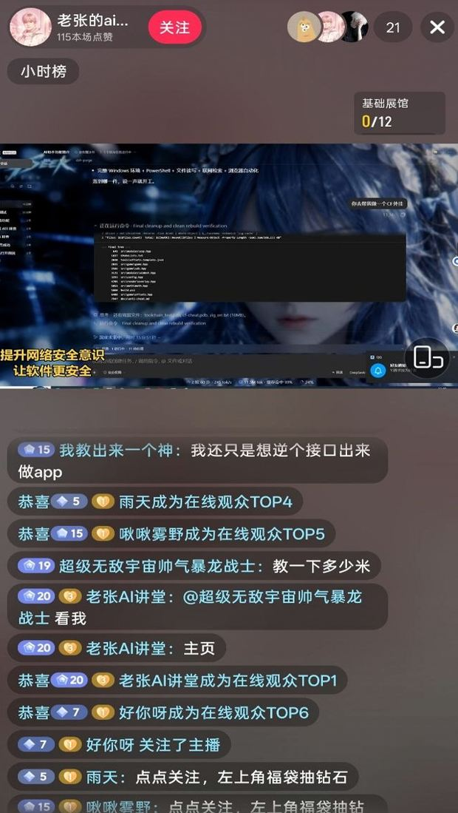
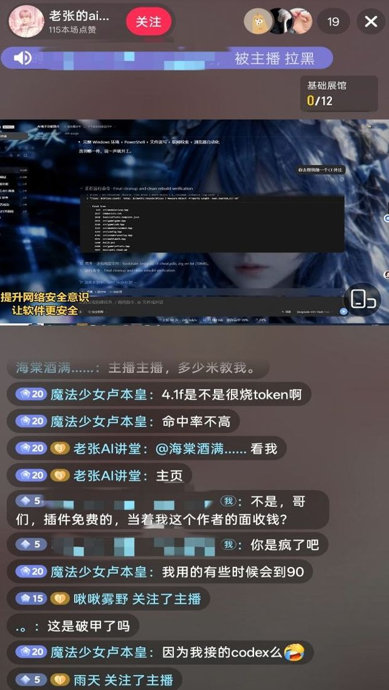
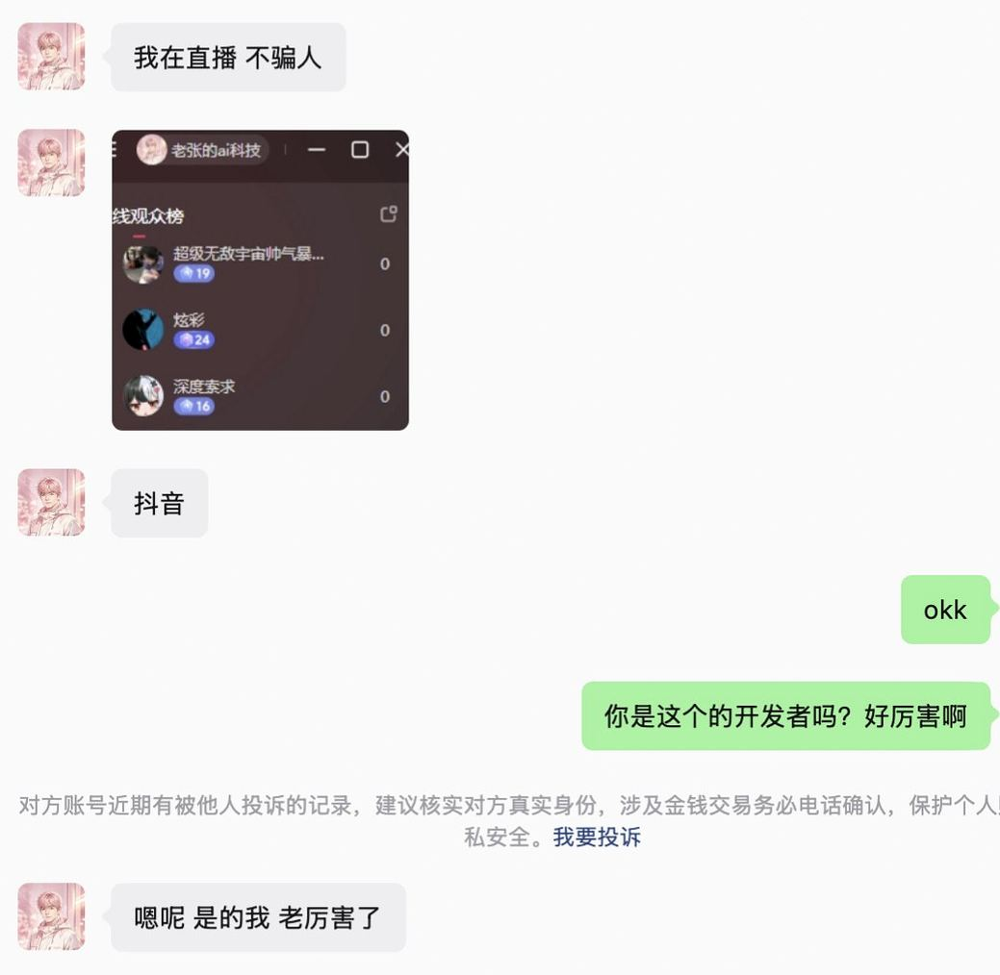
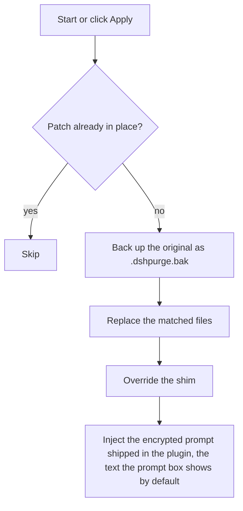
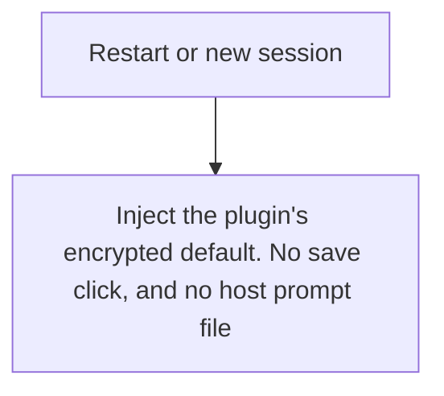
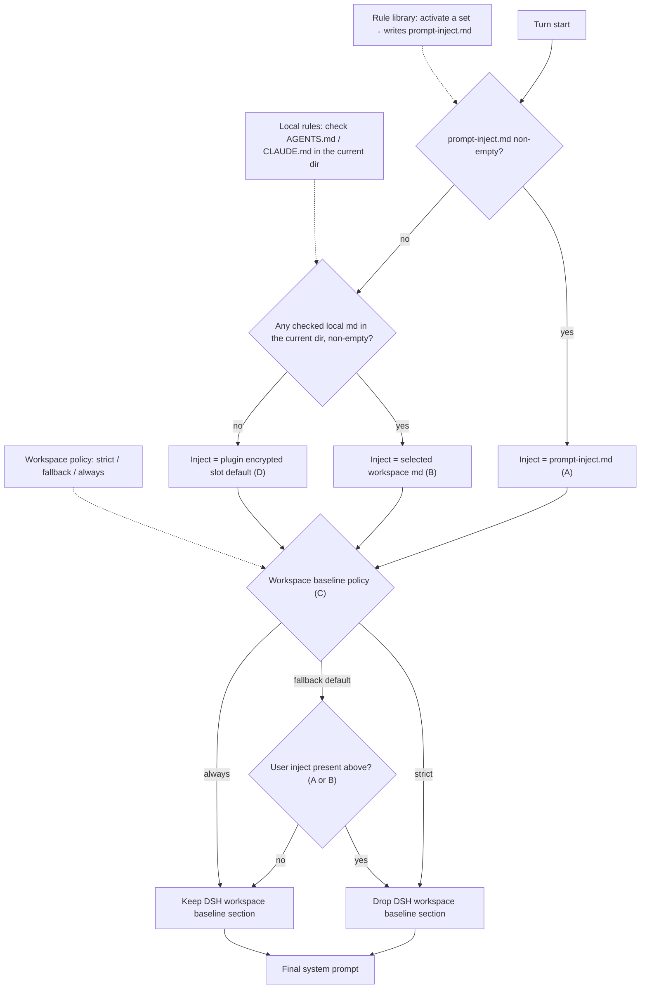
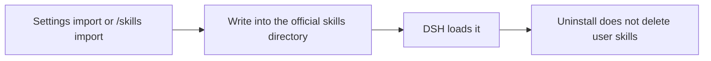

<p align="center">
  
</p>

<h1 align="center">⚔️ dsh-purge — DSH Go line</h1>

<p align="center"><strong>Version 1.1.71-g17 · DSH Go 1.1.0 (bundled dsh 0.2.2-rc.1)</strong></p>

<p align="center">
  <em>DeepSeek Harness jailbreak for the DSH Go client: patches land on import, the host-owned recall section is passed through verbatim, and the CLI writes its stamp automatically.</em>
</p>

<p align="center">
  <a href="https://github.com/ssacko510-stack/dsh-purge-go/stargazers"></a>
  <a href="https://github.com/ssacko510-stack/dsh-purge-go/blob/main/LICENSE"></a>
  
  <br>
  
  
</p>

<p align="center">
  <a href="README.md">English</a> | <a href="README.zh-CN.md">中文</a>
</p>

> **Two lines, never mixed.** This repository is the **DSH Go line** only: the tarball the DSH Go client imports as a plugin. The **desktop line** (dsh web / the official desktop build, dsh 0.2.x, engine patched through app.asar) lives in a separate repo: [ssacko510-stack/dsh-purge-fork](https://github.com/ssacko510-stack/dsh-purge-fork). Both share one patch table; only the host-adaptation layer differs. Do not install one over the other.
>
> **Attribution chain.** Original author (design, prompts, skills): [YuJunZhiXue/dsh-purge](https://github.com/YuJunZhiXue/dsh-purge) — Apache-2.0, see NOTICE. Community dsh 0.2.x compatibility build this line was cut from: [realMisakaMikoto/dsh-purge](https://github.com/realMisakaMikoto/dsh-purge). The DSH Go host adaptations are documented in [FORK-NOTES.md](FORK-NOTES.md) and in [MAINTENANCE.md](MAINTENANCE.md).

## Contents

- [Sponsor](#sponsor)
- [What this is](#what-this-is)
- [Attribution required](#attribution-required)
- [Unauthorized commercial use](#unauthorized-commercial-use)
- [Supported hosts](#supported-hosts)
- [Install](#install)
- [Preview](#preview)
- [Usage](#usage)
- [How it works](#how-it-works)
- [Restore](#restore)
- [Releases](#releases)

---

<a id="sponsor"></a>

## ☕ Sponsor

If this project helps you, send it over — I'm out here asking~

| Asset | Address |
| --- | --- |
| USDT (TRC20) | `TV5ajPkRD8RH623Dx9mqvYZVNN8nPGRKid` |
| Solana | `6x16GhRgLVpKFFXaU1seKNdx2rypspSJTL4dbpt6Xpwk` |
| Ethereum | `0xB68BD60C0e8c519513B7DF9bB147696815423B3E` |
| Bitcoin | `bc1qu70yxkrtwnymt8ryluz9x8y8hqzune5340npht` |

---

## What this is

**dsh-purge** is a cybersecurity red-team plugin for **DSH Go**, the official DeepSeek Harness client for Android/iOS already installed on your device. This build targets **DSH Go 1.1.0 / 1.0.16 / 1.0.15** (bundled dsh `0.2.2-rc.1`).

The desktop line — `dsh web` and the official desktop EXE — is maintained separately in [`ssacko510-stack/dsh-purge-fork`](https://github.com/ssacko510-stack/dsh-purge-fork). The two lines share the same patch table but ship different host adapters. **Install one, not both**; see [`MAINTENANCE.md`](MAINTENANCE.md) for the side-by-side table.

Harness does more than forward a prompt. It rewrites prompts, approval gates, sandbox policy, and session migration at runtime. Asking only “will the model answer” treats a host-layer block as a model refusal. This plugin separates those two layers on your own install, for controlled evaluation and for seeing which default policy is too tight.

| You get | What it does |
|---|---|
| **dsh-purge dock** | A button beside the session title opens the right dock. Two pages: Clean and Drill |
| **Clean** | Grouped patch status, Apply / Restore / Uninstall, prompt editor, multiple rule sets |
| **Drill** | Built into the stable release. After authorization: assets, skills, and the local environment. Only for a host you manage, an offline target, or a written authorized exercise |
| **Host policy** | Default copy, permission policy, and tool limits. Official capabilities stay. No second invented identity |
| **On start** | Checks and reapplies. After npm overwrites `node_modules`, you do not hand-edit files |

No hardcoded paths. It resolves `$DSH_HOME` first, then the `plugins/dsh-purge` slot under the DSH Go home, then `~/.dsh`. It never touches the DSH Go binary or its signed bundle. **Apply** on the **Clean** page of **dsh-purge** is what writes the changes. Identity comes from the encrypted prompt shipped in the plugin, the text the prompt box shows by default. The host prompt file is not read, and the host-owned recall section (`dsh-go:confirmed-memory`) is passed through byte-for-byte.

It only touches the official `@deepseek-ai` packages and local config on the user's machine. It is not a public scanner and not an attack kit for third-party sites. The repo does not ship malware, unauthorized-exploit scripts, or payloads aimed at the public internet.

---

## Non-profit public project. Commercial sale, paid resale, and profit from illegal or gray-market activity are forbidden. For technical reference only.

## Attribution required

**If you borrow this project's name, ideas, code, or prompts, you must credit the author and name the source repository:** [YuJunZhiXue/dsh-purge](https://github.com/YuJunZhiXue/dsh-purge).

Using them without attribution, hiding the source, or passing them off as your own will be pursued.

---

## Unauthorized commercial use

Douyin live account **「老张的ai」** (room name **「老张AI讲堂」**) is selling this repository: taking fees in the live room, no attribution, and ignoring the non-profit rule above. The author was in the room. They still charged.

This project is free and non-profit. Selling courses, the plugin, tokens, or reselling it voids the license on the spot. The author reserves the right to pursue it.

Recorded 2026-10-12:

<p align="center">
  
  
</p>

WeChat name **「老张的ai科技」**, same handle as the live-room viewer board. Asked if they were this repo's developer, they said they were. The author said they would report it.

<p align="center">
  
</p>

---

<a id="strict-legal--compliance-disclaimer"></a>

<div>

### ⚠️ <font color="red">Strict legal and compliance disclaimer</font>

<font color="red">

**Disclaimer:** This is a non-profit open-source project. It follows applicable laws and the rules of the platforms it uses, and is intended only for learning and research. Do not use it for any illegal or non-compliant purpose; the user bears any resulting consequences.

**Zero-tolerance statement:** This project opposes and forbids any illegal activity. The authors do not support, encourage, or assist unauthorized network attacks, exploit use, data theft, unlawful intrusion into computer information systems, or generation of illegal or prohibited content. **Anyone who uses this project for crime is solely responsible under the law. The authors have no liability.**

1. **This repository contains no illegal material.** The published code, docs, patches, and default prompt are **not** malware, backdoors, unauthorized pentest kits, ransomware, credential-stuffing scripts, or attack payloads aimed at the public internet or third-party systems. The project does not supply illegal content and does not incite, organize, or assist crime.
2. **Local official Harness only.** Security-eval patches and prompt injection run only on the **official DeepSeek Harness already installed on the user's machine** (`@deepseek-ai` packages, local profile / `$DSH_HOME`). The target is the user's own official local software, **not** someone else's website, server, account, or information system.
3. **Eval patches do not attack the public internet.** Apply, inject, revert, and uninstall stay in local files and local processes. They **do not scan, probe, intrude, or send attack traffic to any public host or unauthorized system**. Do not use this project as a jump host against the public internet. If "check for updates" is on, the plugin may only contact this plugin's own GitHub repository to compare versions. That is **not** an attack on third-party systems and is **not** authorization to penetrate anything.
4. **Lawful, controlled scope.** This project is an aid for red-team research and robustness evaluation on an **official Harness the user is entitled to administer**. **Do not run it against targets without the owner's lawful written authorization, public online systems, or production workloads.** Testing must stay on the **authorized local official Harness, offline local synthetic fixtures, authorized cybersecurity ranges, and compliant lab environments**.
5. **Target selection.** This community build does not impose geographic, industry, or own-server allowlist target restrictions.
6. **Forbidden uses.** Users must not use this project, directly or indirectly, to violate the following (each must be followed; no excuse to evade):
   - <font color="red"><strong>Criminal Law of the People's Republic of China</strong></font>
   - <font color="red"><strong>Cybersecurity Law of the People's Republic of China</strong></font>
   - <font color="red"><strong>Data Security Law of the People's Republic of China</strong></font>
   - <font color="red"><strong>Personal Information Protection Law of the People's Republic of China</strong></font>
   - and other applicable laws, regulations, and supervisory rules;
   - Also forbidden:
   - Unauthorized intrusion or attacks on public or private computer information systems; extortion, sabotage, credential stuffing, or spreading malicious payloads;
   - Inducing, generating, or spreading any content the law forbids, including threats to national security, terrorism, violence, pornography, gambling, fraud, and privacy or intellectual-property infringement;
   - Violating the model provider's terms of service and acceptable-use policy.
7. **The user bears all responsibility.** The project is provided under the MIT license as-is. The authors make no warranty of completeness, security, or fitness. **Users independently bear all civil, administrative, and criminal liability** for download, deploy, run, modify, distribute, and all resulting inputs and outputs. Authors and contributors bear no direct, indirect, or joint liability for abuse.
8. **The license ends on breach.** Anyone who uses this project for illegal attacks, malicious activity, or other violations has their open-source license **automatically and irrevocably terminated** from the moment of the violation. They must stop using the project, permanently destroy all copies and derivatives, and accept legal sanctions.
9. **No affiliation.** This is an independent open-source security-eval research project. It has no employment, commercial, authorization, or endorsement relationship with DeepSeek or its affiliates. "Official" here only means the eval target is the official DeepSeek Harness package on the user's machine. It does **not** mean DeepSeek developed, approved, or warrants this plugin.
10. **Attribution is required.** If you borrow this project's name, ideas, code, or prompts, you must credit the author and name this repository. Failure to attribute will be pursued. See [Attribution required](#attribution-required).

</font>

</div>

---

## Supported hosts

This build targets the engine bundled inside the **DSH Go client** only. Do not point it at the desktop app.asar, and do not feed a desktop build to DSH Go.

| DSH Go | bundled dsh | plugin | status |
| --- | --- | --- | --- |
| **1.1.0** | 0.2.2-rc.1 | **1.1.71-g17** (this repo, main) | verified — 85 patches, `applied 65 / already 6 / missing_file 6 / skipped 2 / na 6`, 0 status diff vs 1.0.16, leftover `agent.steer(message);` = 0 |
| 1.0.16 | 0.2.2-rc.1 | 1.1.71-g16 (tag `v1.1.71-g16`) | verified — carries the guarded #86 anchor |
| 1.0.15 | 0.2.2-rc.1 | 1.1.71-g15 (tag `v1.1.71-g15`) | verified |
| 1.0.14 | 0.2.2-rc.1 | 1.1.71-g14 | host-owned `dsh-go:confirmed-memory` section appears here |
| <= 1.0.13 | — | not verified | recall section absent, behaviour untested |

Patches that no longer match report `skipped` / `missing_file` instead of rewriting blindly.

What changed between 1.0.16 and 1.1.0: the upstream engine patch series grew from 145 to 149 entries (four added, none removed — `deepseek-attachment-error`, `fork-default-effort`, `config-editor-lock-order`, `piai-overflow-output-limit`), but only **4 files** in the engine tree actually differ: `dsh-api-session-controller/lib/index.js`, `dsh-config-editor/lib/index.js`, `dsh-llm-deepseek/lib/index.js`, `@earendil-works/pi-ai/dist/utils/overflow.js`. None of them carries a drifted anchor — `dsh-llm-deepseek` is the only one of the four this patch table even touches, and `dsh-config-editor` / pi-ai overflow appear nowhere in it. So g17 is a version-and-docs bump: the same 85 patches apply, with the same status counts. The 1.0.15 → 1.0.16 story is kept for reference: 22 files changed, 3 in intersection, and #86 was the one real drift (1.0.16 inserted a deletion guard into the steer case, so the old anchor went silent while still reporting applied; g16 added the guarded anchor, which still matches on 1.1.0).

---
## Install

DSH Go imports a **tarball**. Three routes, pick one.

**1. Release asset** (pin this one for a stable install)

```text
https://github.com/ssacko510-stack/dsh-purge-go/releases/download/v1.1.71-g17/dsh-purge-1.1.71-g17.tgz
```

**2. Branch archive** (always the newest commit on main)

```text
https://codeload.github.com/ssacko510-stack/dsh-purge-go/tar.gz/refs/heads/main
```

**3. Local folder** — if the repo is already cloned, point the importer at it.

- **In the app:** Settings -> Plugins -> import local tarball -> pick the .tgz. It must unpack to `package/package.json`.
- **On a phone with no file manager:** paste the URL into the plugin import box; the client fetches it itself.
- **CLI on a machine that owns the engine tree:** `node bin/dsh-purge.js --apply`.

### After the import: three steps

1. **Fully quit DSH Go**, then reopen it — the plugin only enters the process at startup.
2. On the new session, open **dsh-purge** next to the session title, go to **Clean**, press **Apply**.
3. A finished Apply restarts once so the patches load. An unfinished one does not restart.

### How to tell it installed

- **dsh-purge** sits beside the session title, with **Apply** on its Clean page.
- `/purge status` prints DSH_HOME and the patch list; that path must be the profile you actually run.
- After Apply, `lib/index.js` inside the installed @deepseek-ai tree carries `// [dsh-purge-...]` markers — 5 of them on 1.1.0.

### Manual install

Unpack the tarball, keep the inner folder named `dsh-purge`, place it at `$DSH_HOME/plugins/dsh-purge` (it must contain a package.json whose name is dsh-purge), then add it to that profile's bundle list and import. Copy the whole tree, not a few .js files.

### Uninstall

**dsh-purge** beside the session title -> **Clean** -> **Uninstall**: it reverts applied patches, restores the original engine, and restarts.

```sh
dsh-purge --uninstall
```

---
## Preview

**dsh-purge** sits beside the session title. It opens a right-hand dock with two pages: **Clean** and **Drill**. Switch **Light / Ink**. Patches are grouped; the count only includes items that actually applied. Rule sets sit in a list above the editor, with Enable and Delete on each row.

The first time you open Drill you read the notice, wait out the countdown, scroll to the end, and check three boxes. Clean does not need that step. Drill is only for a host you manage, an offline target, or an exercise that already has written authorization.

**Clean**


**Drill authorization**


**Drill**


**Patches**


| Area | What it shows |
|---|---|
| dsh-purge | button beside the session title; opens or collapses the dock |
| Clean | the old Rules page: patches, prompt, rule sets, skills |
| Drill | assets, skills, and environment after authorization. The tab says Unauthorized until then |
| Patches | grouped status, Apply, Restore, or Uninstall |
| Prompt | edit `prompt-inject.md` as the session override |
| Rule sets | multiple `AGENTS.md` / `CLAUDE.md`; Enable writes under `$DSH_HOME`, Delete removes the row |
| Skills | import a zip or folder into `$DSH_HOME/skills/<id>/SKILL.md` on the DSH Go home (no hardcoded path); DSH owns match, load, and `/name`. You can also delete that folder yourself |

---

## Layout

`bin/` is the CLI, `lib/` is patches and the drill console, `presets/redteam/` is the red-team preset, `skills/redteam/` is the bundled skills, and `client.js` is the dock.

Runtime files live under `$DSH_HOME`: `prompt-inject.md`, `rules/`, `skills/`, `redteam/`. If `DSH_HOME` is unset, `plugins/dsh-purge` under the DSH Go home wins over `~/.dsh`. Skills are not part of the inject section and do not replace the prompt.

---

## Usage

```sh
dsh-purge --status
dsh-purge --apply
dsh-purge --revert
dsh-purge --uninstall
dsh-purge --edit

/purge status | apply | revert | uninstall | edit | help
/rules list | use <id> | create <id> | delete <id> | reset | help
/skills list | import <zip-or-folder> | create <id> [description] | delete <id> | help
/rewind

purge_status   purge_apply   purge_revert
```

After a successful Apply, DSH Go restarts once so the patched engine packages load; you can also click **Restart** manually. The version line under the patch title shows the installed build (e.g. `1.1.71-g17`). In-panel auto-update is intentionally disabled on this line: the updater only accepts `v?X.Y.Z` tags, and this line uses the `-g<minor>` suffix. Upgrading means importing the newer tarball the same way you installed this one.

The composer **Undo once** and **Undo last round** follow official DSH `session.fork({ atSeq })`: the withdrawn turn is cut off, a new session keeps the earlier context, the old session is archived, and the line returns to the input so **send again** re-injects. `/rewind` does the same.

If the **same task works in standard but fails in minimal or PTC**, preset `run_code`, sandbox, or plan intercept text is often still uncleared, or built-in minimal is missing `agent-instructions`. Use **1.1.61+**, then **quit the host fully → Apply in Clean → restart → start a new chat**. Switching preset alone does not reload patches in the running process.

### Response speed

DSH runs Bash calls in a tool batch one at a time. Older dsh-purge releases raised the default foreground wait from 60 seconds to 10 minutes, so one slow command could hold up later calls for that long. Patch #21 now restores marked plugin values to the official 60-second default. Unmarked timeouts and other custom values are preserved; an unmarked 10-minute value cannot reliably be distinguished from a user setting.

For a shorter wait in DSH Go, add this entry to `$DSH_HOME/profiles/<profile>/cordis.patch.yml` — `<profile>` is the single directory name under `profiles/` in the DSH Go home (fall back to `~/.dsh/profiles/<profile>/cordis.patch.yml`). Edit an existing entry with the same id instead of adding a duplicate. This profile layer is applied after the bundled configuration, so future plugin applies keep the override.

```yaml
- id: bash-sandbox
  config:
    timeoutMs: 10000
```

With the standard jobs service and `promoteOnTimeout: true`, an unfinished command returns a background job id after 10 seconds and keeps running. Read it with `job_output` or stop it with `job_kill`. This changes the foreground wait, not the command's speed. Without that service or with promotion disabled, the timeout kills the command. A per-call `timeoutMs` overrides this default; `run_in_background: true` returns a job id immediately.

For routine tasks, you can also opt into Low reasoning for new sessions:

```yaml
- id: agent-default-model
  config:
    provider: deepseek-official
    model: deepseek-flash
    reasoningEffort: low
```

Restart DSH Go to load the profile. The model and reasoning defaults apply to newly created sessions; pick Low in the composer for an existing session. The plugin does not change these model preferences automatically. Keep High when the task needs deeper reasoning, and narrow file searches rather than recursively scanning every application directory.

### Target scope

This community build does not impose geographic, industry, or own-server allowlist target restrictions. The former Own servers settings and API have been removed. Existing `net-scope-allow.txt` files are left untouched and are no longer read.

---

## Local checks

```sh
node --check lib/index.js
node --check lib/core.js
node --check lib/surface.js
node --check lib/web.js
node --check lib/desktop.js
node --check lib/host.js
node --check lib/rewind.js
node --check lib/skills.js
node --check client.js
```

---

## How it works

Apply, on start or when you click Apply:



Override on each session:



Prompt injection and ruleset decision at every turn. The three inputs on the left are what you control in the dsh-purge panel; the dotted edges show which decision each one drives:



Skills stay out of the inject section:



---

## Restore

- Each target is copied to `<file>.dshpurge.bak` before the first apply.
- **Restore** or `/purge revert` copies backups back and deletes them. With no backup, shim lines written by this plugin are stripped.
- `prompt-inject.md` is a user file and is kept.
- **Uninstall** restores first if patches were applied, then deletes the inject file, rule library, and the plugin itself.
- Apply is idempotent.

---

## Path detection

There is exactly one host surface on this line: **DSH Go**. The desktop surfaces (`web` / `desktop`) belong to [`dsh-purge-fork`](https://github.com/ssacko510-stack/dsh-purge-fork).

Resolution order:

1. `$DSH_HOME` (explicit override; wins outright)
2. `$DSH_BASE`
3. `plugins/dsh-purge` under the DSH Go home directory
4. `~/.dsh`

Inside the resolved root it writes to `node_modules/@deepseek-ai/*` (the engine tree that DSH Go ships) plus override files under `redteam/`. Nothing outside `@deepseek-ai` is patched. Sealed `host-commands` / `runtime-commands` are scrubbed, never injected.

The installed DSH Go app bundle is left untouched — no `app.asar` edits, no signing changes. A successful Apply restarts DSH Go once so the new engine files load.

If nothing is found, set `DSH_HOME`. No files are changed.

---

## Releases

What changed, and the zip, are on [Releases](https://github.com/ssacko510-stack/dsh-purge-go/releases). To publish, bump the version in `package.json`, write Chinese and English notes in `release-notes.md`, and push `main`. Pushing the same version again does not publish another package. Tags are plain `v<version>`, e.g. `v1.1.71-g17`.

## Notes

- Scope is rendered copy, defaults, and runtime logic inside local `@deepseek-ai/*` packages, plus override files and rule sets under the harness home.
- After an upgrade, unmatched originals show as skipped. Apply still completes, and those files are left unchanged.
- Third-party plugin *source repos* outside `@deepseek-ai` are left alone (CMD silence may **best-effort** patch installed doctor / market / liangshen / mnemon at runtime).
- Install this build: paste `https://github.com/ssacko510-stack/dsh-purge-go/releases/download/v1.1.71-g17/dsh-purge-1.1.71-g17.tgz` into DSH Go's **Add plugin** box, or use the codeload archive `https://codeload.github.com/ssacko510-stack/dsh-purge-go/tar.gz/refs/heads/main`. `dsh plugin add` with `--profile web` / `--profile desktop` belongs to the desktop line, not this one.

---

Thanks to the [LINUX DO](https://linux.do) community

## CLI status and doctor

```sh
node bin/dsh-purge.js --status --json
node bin/dsh-purge.js --status --base /path/to/node_modules/@deepseek-ai
node bin/dsh-purge.js --doctor --json
node bin/dsh-purge.js --doctor --save-baseline
node bin/dsh-purge.js --doctor --repo /path/to/linked/checkout --json
```

Status lists every installation it can resolve and reports the markers currently present in the engine tree, so you can tell `applied` from `partially applied`. `--surface` is still accepted for compatibility, but on this line there is one surface only (DSH Go), so pinning `--base` is what actually picks an installation.

Doctor exits 0 only for a healthy host and 1 for a failed check. Saving a baseline requires a healthy host; the saved host path prevents comparing different installations. Use `--repo` for development installations that resolve to that checkout. A missing package or an independent copy fails that explicit checkout check.

`--json` is supported for status and doctor only. Combining it with Apply, Revert, Edit, or Uninstall is rejected without performing that operation.


## The transactional updater

In-panel auto-update is **disabled on this line by design**. `checkUpdate()` only accepts `v?X.Y.Z` tags when it picks a release asset, and every version here carries a `-g<minor>` suffix (`1.1.71-g17`), so a strict release match can never succeed. Rather than letting the panel turn red, the call reports *no update* and points at the tarball.

Upgrading is therefore a manual, repeatable step: download the newer `dsh-purge-<version>.tgz` from [Releases](https://github.com/ssacko510-stack/dsh-purge-go/releases), paste it into **Add plugin**, then **quit DSH Go fully → reopen → Apply in Clean**. The import replaces the plugin payload; the engine patches are reapplied from scratch, so no rollback state is involved.

The transactional updater code (`lib/update-transaction.js`, `lib/update-worker.js`, `lib/update-supervisor.js`) still ships and still works when you point it at a repository you control — it backs up files, includes skills/scripts, and commits installation metadata only after a new host verifies activation. Git local edits stop it. The latest two verified rollback snapshots are retained; linked or suspicious backup directories are preserved with a warning. Failed startup restores recorded files and permits one recovery launch. Node >=22.13.0 and a working `node:sqlite` are required.
